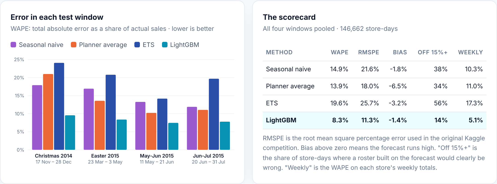
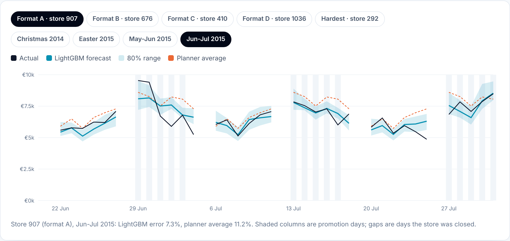
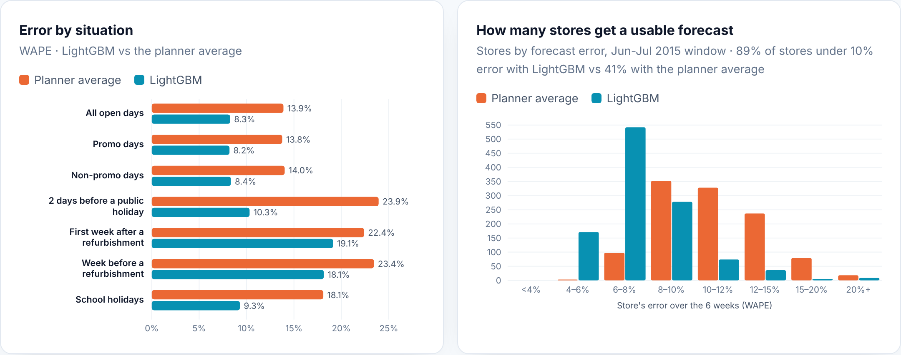

# Store Sales Forecasting

**How much will each of 1,115 drugstores sell on each day of the next six weeks, and how far can that number be trusted?**

Store managers plan staff and stock about six weeks ahead, so forecast errors become empty shelves or queues at the till. This project builds a SQL feature pipeline on 1,017,209 store-days of real sales from Rossmann, a European drugstore chain, then tests four forecasting methods the way they would be used for real: six weeks at a time, using only data from before each window.

**[▶ View the interactive report](https://pervejhosen.com/projects/store-sales-forecasting/)**



---

## Key findings

| | Finding |
|---|---|
| **13.9% → 8.3%** | One LightGBM model for all stores cuts the daily forecast error (WAPE) by **40%** compared with a planner's 12-week weekday average, and by **45%** compared with copying last year. |
| **34% → 14%** | of store-days are off by more than 15%, the point where a roster built on the forecast is clearly wrong. On weekly store totals the error is **5.1%**. |
| **+39%** | sales on a promotion day, like for like, but only +21% more customers: promotions grow the basket as much as the footfall. Exponential smoothing, which can't see the promotion calendar, loses even to the simple planner average (19.6% error). |
| **−10%** | sales, lasting at least six months, when a competitor opens nearby (measured against the rest of the chain over the same weeks). |
| **69%** | of actual values fell inside the 80% prediction range: the range is too narrow and needs recalibrating before it drives safety stock. |

## The four methods

| Step | Method | How it forecasts | WAPE | RMSPE |
|---|---|---|---|---|
| 1 | Seasonal naive | Same weekday 52 weeks earlier | 14.9% | 21.6% |
| 2 | Planner average | Store's weekday average over the last 12 weeks, split by promotion week | 13.9% | 18.0% |
| 3 | ETS | Exponential smoothing with a weekly season, per store (statsforecast AutoETS) | 19.6% | 25.7% |
| 4 | **LightGBM** | One model for all stores with calendar, promotion, holiday, refurbishment, competitor and store-history features; quantile models for the 80% range | **8.3%** | 11.3% |

Scores are pooled over four 6-week test windows (146,662 open store-days): Christmas 2014, Easter 2015, May to June 2015 and June to July 2015. WAPE is total absolute error as a share of actual sales. RMSPE is the metric from the original Kaggle competition.



## Validation design

- **Rolling origin.** Each window is forecast by models trained only on data before it starts. Nothing from a test window is used for training or tuning.
- **No leakage through features.** Every feature for a forecast day is either known in advance (the promotion calendar, public and school holidays, planned refurbishment closures, store facts) or measured at least 42 days earlier, so it exists on the day the forecast is made.
- **Scored where it matters.** Open days with recorded sales only. 68 recording errors (open with zero or near-zero sales) are flagged in silver and never trained on or scored.
- **Errors broken down.** By window, store format, promotion status, holidays and refurbishments, plus the store-level spread and the coverage of the prediction range.



## How it was built

```
data/raw/train.csv, store.csv     Rossmann Store Sales (Kaggle), see data/README.md
        │
sql/01_bronze.sql        BRONZE  raw files loaded as published
sql/02_silver.sql        SILVER  typed and cleaned, recording errors flagged
sql/03_gold_features.sql GOLD    one row per store-day with 24 model features
sql/04_gold_insights.sql         weekday, promotion, school holiday and competitor effects
        │
forecast.py              rolling 6-week backtests: seasonal naive, planner average, ETS, LightGBM (+ quantile range)
report_data.py           scores, error breakdowns and examples for the report
        │
output/*.csv  +  report/index.html (interactive report)
```

The SQL uses window functions with `RANGE` frames for the lagged features and ports to Snowflake or BigQuery with minor syntax changes.

## Run it yourself

```bash
pip install -r requirements.txt
# put train.csv and store.csv in data/raw/ (see data/README.md)
python run.py
```

The full backtest takes about 25 minutes on a 2-core machine. Open `report/index.html` to view the report locally.

## Data

Rossmann Store Sales, Kaggle competition, 2015. https://www.kaggle.com/competitions/rossmann-store-sales. The data is not redistributed here.

---

Built by **[Pervej Hosen](https://pervejhosen.com)** · Sr. Power BI Developer & Analytics Engineer
